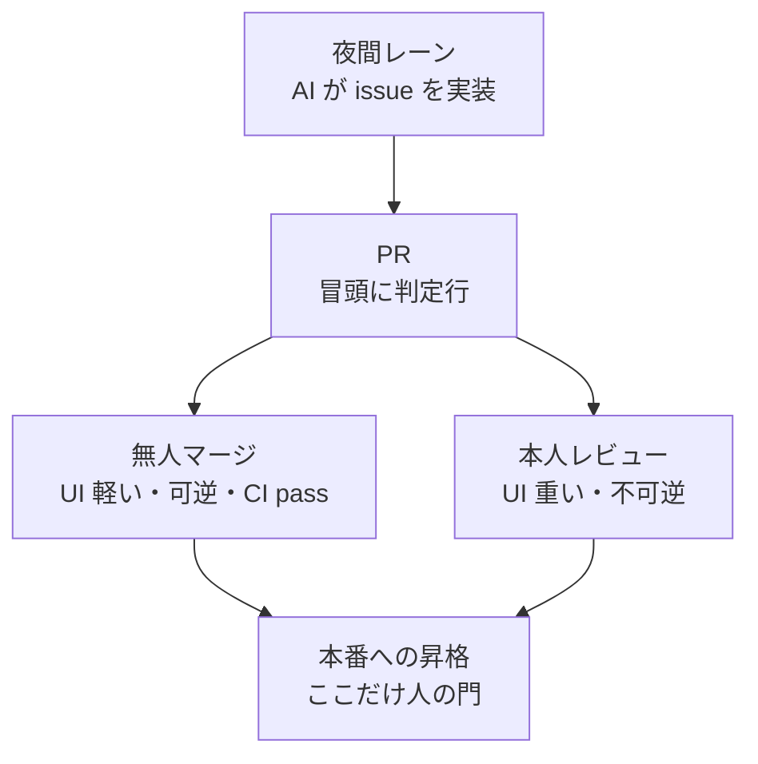

### 小谷 未知 / Michi Kotani

1人と AI エージェントのチームで、受託のプロダクトを並走で作っています。株式会社unknown 代表。

仕事のほとんどは private リポにあるので、ここには作り方だけ置きます。

- 夜に AI が issue を実装して PR を出し、昼は人が PR だけを見る
- 人が必ず見るのは「UI/UX の重い変更」と「戻せない変更」の2つだけ
- 削除・本番反映・外部送信は hook で止め、AI が単独で通れないようにしている

**直近12か月**　マージした PR 3,219 ・ 起票した issue 1,942 ・ 直近90日に動いたリポ 19

**使うもの**　TypeScript（Bun / Node）· Next.js · Tailwind CSS v4 + shadcn/ui · Python · Cloudflare · Vercel · Claude Code · Codex

**連絡**　[un-known.pro](https://un-known.pro) ・ michi@un-known.pro
